# Chart Types in controlcharts

## Overview

The `controlcharts` package supports a comprehensive range of
Statistical Process Control (SPC) charts and funnel plots. This vignette
demonstrates all available chart types with examples of their usage.

## SPC Chart Types

The package supports 14 different SPC chart types, each designed for
specific data characteristics and monitoring scenarios.

### Basic Charts

#### Run Chart

A run chart displays data over time without statistical control limits.
It’s useful for visualizing trends and patterns in data.

``` r

# Simulate 24 months of data
dat_run <- data.frame(
  month = seq(as.Date("2024-01-01"), length.out = 24, by = "month"),
  y = rnorm(24, mean = 100, sd = 10)
)

chart_run <- spc(data = dat_run,
                 keys = month,
                 numerators = y,
                 spc_settings = list(chart_type = "run"))

chart_run$static_plot
```

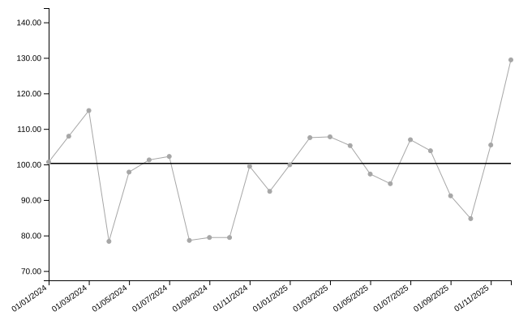

``` r

knitr::kable(head(chart_run$limits), digits = 2)
```

| date       |  value | target | trend_line |
|:-----------|-------:|-------:|-----------:|
| 01/01/2024 | 100.67 | 100.29 |      94.37 |
| 01/02/2024 | 107.95 | 100.29 |      94.74 |
| 01/03/2024 | 115.18 | 100.29 |      95.11 |
| 01/04/2024 |  78.35 | 100.29 |      95.48 |
| 01/05/2024 |  97.86 | 100.29 |      95.85 |
| 01/06/2024 | 101.29 | 100.29 |      96.22 |

#### Individuals Chart (i-chart)

The individuals chart (also called an XmR chart) is the default chart
type. It monitors individual measurements with control limits based on
the moving range.

``` r

dat_i <- data.frame(
  month = seq(as.Date("2024-01-01"), length.out = 24, by = "month"),
  y = rnorm(24, mean = 50, sd = 5)
)

chart_i <- spc(data = dat_i,
               keys = month,
               numerators = y,
               spc_settings = list(chart_type = "i"))

chart_i$static_plot
```

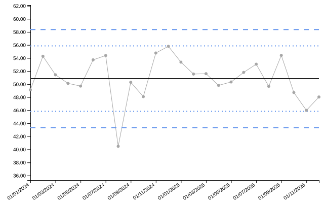

``` r

knitr::kable(head(chart_i$limits), digits = 2)
```

| date       | value | target |  ll99 |  ll95 |  ll68 |  ul68 |  ul95 |  ul99 | trend_line |
|:-----------|------:|-------:|------:|------:|------:|------:|------:|------:|-----------:|
| 01/01/2024 | 49.13 |  50.86 | 43.35 | 45.85 | 48.36 | 53.36 | 55.86 | 58.36 |      51.48 |
| 01/02/2024 | 54.28 |  50.86 | 43.35 | 45.85 | 48.36 | 53.36 | 55.86 | 58.36 |      51.43 |
| 01/03/2024 | 51.43 |  50.86 | 43.35 | 45.85 | 48.36 | 53.36 | 55.86 | 58.36 |      51.37 |
| 01/04/2024 | 50.12 |  50.86 | 43.35 | 45.85 | 48.36 | 53.36 | 55.86 | 58.36 |      51.32 |
| 01/05/2024 | 49.71 |  50.86 | 43.35 | 45.85 | 48.36 | 53.36 | 55.86 | 58.36 |      51.26 |
| 01/06/2024 | 53.72 |  50.86 | 43.35 | 45.85 | 48.36 | 53.36 | 55.86 | 58.36 |      51.21 |

#### Individuals Chart with Ratios

i-charts can also monitor ratios by providing both numerators and
denominators. The chart will automatically calculate and plot the ratio
with appropriate control limits.

``` r

# Example: monitoring average processing time per case
dat_ratio <- data.frame(
  month = seq(as.Date("2024-01-01"), length.out = 24, by = "month"),
  total_time = rpois(24, lambda = 120),
  num_cases = rpois(24, lambda = 25)
)

chart_ratio <- spc(data = dat_ratio,
                   keys = month,
                   numerators = total_time,
                   denominators = num_cases,
                   spc_settings = list(chart_type = "i"))

chart_ratio$static_plot
```

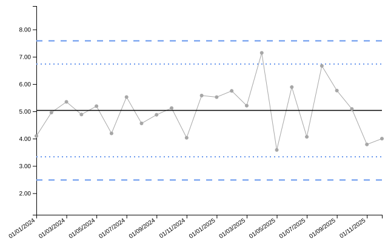

``` r

knitr::kable(head(chart_ratio$limits), digits = 2)
```

| date | numerator | denominator | value | target | ll99 | ll95 | ll68 | ul68 | ul95 | ul99 | trend_line |
|:---|---:|---:|---:|---:|---:|---:|---:|---:|---:|---:|---:|
| 01/01/2024 | 127 | 31 | 4.10 | 5.03 | 2.49 | 3.34 | 4.18 | 5.88 | 6.73 | 7.58 | 4.93 |
| 01/02/2024 | 114 | 23 | 4.96 | 5.03 | 2.49 | 3.34 | 4.18 | 5.88 | 6.73 | 7.58 | 4.94 |
| 01/03/2024 | 123 | 23 | 5.35 | 5.03 | 2.49 | 3.34 | 4.18 | 5.88 | 6.73 | 7.58 | 4.95 |
| 01/04/2024 | 127 | 26 | 4.88 | 5.03 | 2.49 | 3.34 | 4.18 | 5.88 | 6.73 | 7.58 | 4.96 |
| 01/05/2024 | 109 | 21 | 5.19 | 5.03 | 2.49 | 3.34 | 4.18 | 5.88 | 6.73 | 7.58 | 4.97 |
| 01/06/2024 | 109 | 26 | 4.19 | 5.03 | 2.49 | 3.34 | 4.18 | 5.88 | 6.73 | 7.58 | 4.98 |

#### Individuals Chart with Median Centerline (i_m)

Uses the median instead of the mean for the centerline, making it more
robust to outliers.

``` r

dat_im <- data.frame(
  month = seq(as.Date("2024-01-01"), length.out = 24, by = "month"),
  y = c(rnorm(20, mean = 50, sd = 5), 75, 78, 72, 71)  # Some outliers
)

chart_im <- spc(data = dat_im,
                keys = month,
                numerators = y,
                spc_settings = list(chart_type = "i_m"))

chart_im$static_plot
```

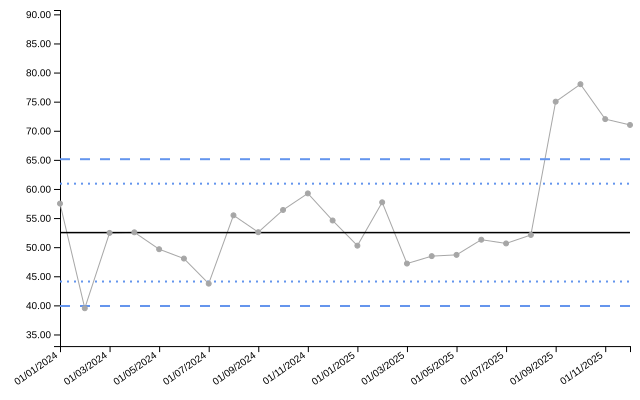

#### Individuals Chart with Median Limits (i_mm)

You can use both median centerline and median-based moving range limits.

``` r

chart_imm <- spc(data = dat_im,
                 keys = month,
                 numerators = y,
                 spc_settings = list(chart_type = "i_mm"))

chart_imm$static_plot
```

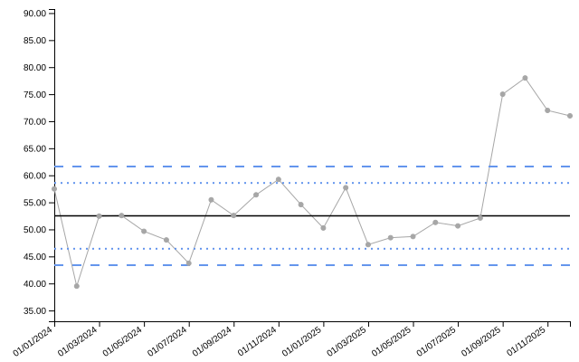

#### Moving Range Chart (mr)

Plots the moving range between consecutive measurements.

``` r

dat_mr <- data.frame(
  month = seq(as.Date("2024-01-01"), length.out = 24, by = "month"),
  y = rnorm(24, mean = 10, sd = 2)
)

chart_mr <- spc(data = dat_mr,
                keys = month,
                numerators = y,
                spc_settings = list(chart_type = "mr"))

chart_mr$static_plot
```

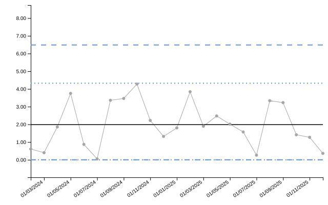

### Proportion Charts

#### p-chart (Proportions)

Monitors proportions when the numerator cannot exceed the denominator
(e.g., defect rates, complication rates).

``` r

dat_p <- data.frame(
  month = seq(as.Date("2024-01-01"), length.out = 24, by = "month"),
  denominator = sample(80:120, 24, replace = TRUE)
)
dat_p$numerator <- rbinom(24, size = dat_p$denominator, prob = 0.15)

chart_p <- spc(data = dat_p,
               keys = month,
               numerators = numerator,
               denominators = denominator,
               spc_settings = list(chart_type = "p"))

chart_p$static_plot
```

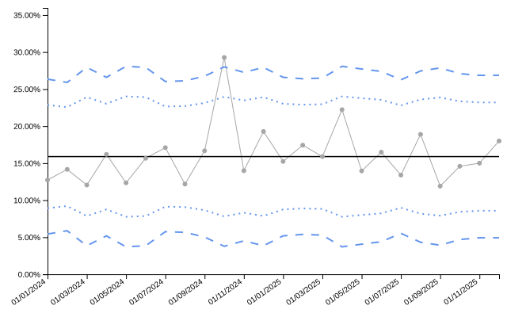

``` r

knitr::kable(head(chart_p$limits), digits = 3)
```

| date | numerator | denominator | value | target | ll99 | ll95 | ll68 | ul68 | ul95 | ul99 | trend_line |
|:---|---:|---:|---:|---:|---:|---:|---:|---:|---:|---:|---:|
| 01/01/2024 | 14 | 110 | 12.727 | 15.889 | 5.432 | 8.918 | 12.403 | 19.374 | 22.860 | 26.345 | 15.173 |
| 01/02/2024 | 17 | 120 | 14.167 | 15.889 | 5.877 | 9.214 | 12.551 | 19.226 | 22.563 | 25.900 | 15.247 |
| 01/03/2024 | 10 | 83 | 12.048 | 15.889 | 3.851 | 7.863 | 11.876 | 19.901 | 23.914 | 27.927 | 15.321 |
| 01/04/2024 | 17 | 105 | 16.190 | 15.889 | 5.186 | 8.753 | 12.321 | 19.456 | 23.024 | 26.591 | 15.395 |
| 01/05/2024 | 10 | 81 | 12.346 | 15.889 | 3.703 | 7.765 | 11.827 | 19.951 | 24.012 | 28.074 | 15.469 |
| 01/06/2024 | 13 | 83 | 15.663 | 15.889 | 3.851 | 7.863 | 11.876 | 19.901 | 23.914 | 27.927 | 15.543 |

#### p-prime Chart (pp)

Proportion chart with large-sample correction for better accuracy with
varying sample sizes.

``` r

chart_pp <- spc(data = dat_p,
                keys = month,
                numerators = numerator,
                denominators = denominator,
                spc_settings = list(chart_type = "pp"))

chart_pp$static_plot
```

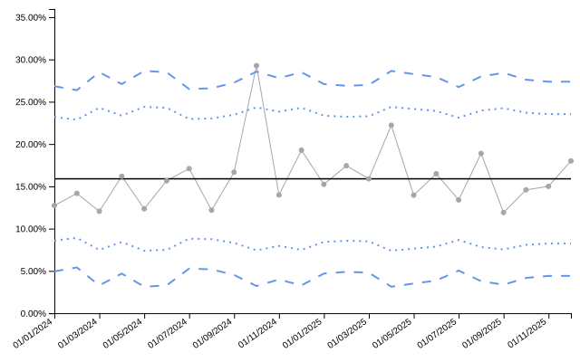

### Rate Charts

#### u-chart (Rates)

Monitors rates (events per unit exposure), such as infections per 1000
patient-days.

``` r

dat_u <- data.frame(
  month = seq(as.Date("2024-01-01"), length.out = 24, by = "month"),
  infections = rpois(24, lambda = 8),
  patient_days = sample(200:400, 24, replace = TRUE)
)

chart_u <- spc(data = dat_u,
               keys = month,
               numerators = infections,
               denominators = patient_days,
               spc_settings = list(chart_type = "u", multiplier = 1000))

chart_u$static_plot
```

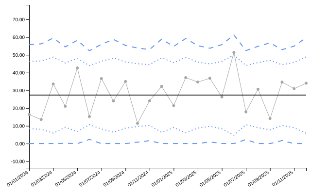

``` r

knitr::kable(head(chart_u$limits), digits = 2)
```

| date | numerator | denominator | value | target | ll99 | ll95 | ll68 | ul68 | ul95 | ul99 | trend_line |
|:---|---:|---:|---:|---:|---:|---:|---:|---:|---:|---:|---:|
| 01/01/2024 | 5 | 305 | 16.39 | 27.35 | 0.00 | 8.41 | 17.88 | 36.82 | 46.28 | 55.75 | 23.83 |
| 01/02/2024 | 4 | 295 | 13.56 | 27.35 | 0.00 | 8.09 | 17.72 | 36.98 | 46.60 | 56.23 | 24.21 |
| 01/03/2024 | 8 | 238 | 33.61 | 27.35 | 0.00 | 5.91 | 16.63 | 38.07 | 48.79 | 59.50 | 24.58 |
| 01/04/2024 | 7 | 333 | 21.02 | 27.35 | 0.16 | 9.22 | 18.28 | 36.41 | 45.47 | 54.53 | 24.96 |
| 01/05/2024 | 11 | 258 | 42.64 | 27.35 | 0.00 | 6.76 | 17.05 | 37.64 | 47.94 | 58.23 | 25.34 |
| 01/06/2024 | 6 | 394 | 15.23 | 27.35 | 2.35 | 10.68 | 19.02 | 35.68 | 44.01 | 52.34 | 25.72 |

#### u-prime Chart (up)

Rate chart with large-sample correction.

``` r

chart_up <- spc(data = dat_u,
                keys = month,
                numerators = infections,
                denominators = patient_days,
                spc_settings = list(chart_type = "up", multiplier = 1000))

chart_up$static_plot
```

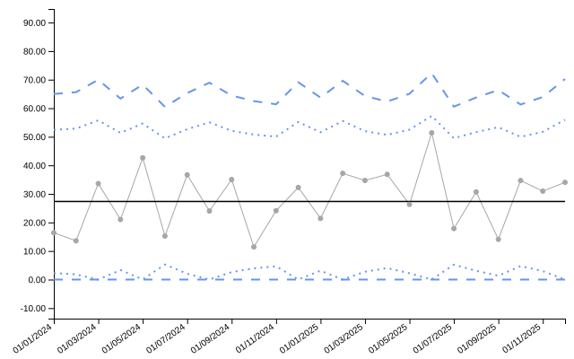

### Count Charts

#### c-chart (Counts)

Monitors count data where each observation represents the number of
events in a fixed area of opportunity.

``` r

dat_c <- data.frame(
  month = seq(as.Date("2024-01-01"), length.out = 24, by = "month"),
  defects = rpois(24, lambda = 12)
)

chart_c <- spc(data = dat_c,
               keys = month,
               numerators = defects,
               spc_settings = list(chart_type = "c"))

chart_c$static_plot
```

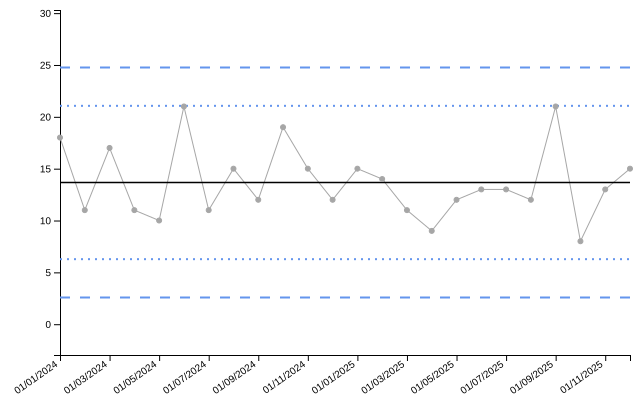

``` r

knitr::kable(head(chart_c$limits), digits = 2)
```

| date       | value | target | ll99 | ll95 | ll68 |  ul68 |  ul95 |  ul99 | trend_line |
|:-----------|------:|-------:|-----:|-----:|-----:|------:|------:|------:|-----------:|
| 01/01/2024 |    18 |  13.67 | 2.58 | 6.27 | 9.97 | 17.36 | 21.06 | 24.76 |      14.51 |
| 01/02/2024 |    11 |  13.67 | 2.58 | 6.27 | 9.97 | 17.36 | 21.06 | 24.76 |      14.43 |
| 01/03/2024 |    17 |  13.67 | 2.58 | 6.27 | 9.97 | 17.36 | 21.06 | 24.76 |      14.36 |
| 01/04/2024 |    11 |  13.67 | 2.58 | 6.27 | 9.97 | 17.36 | 21.06 | 24.76 |      14.29 |
| 01/05/2024 |    10 |  13.67 | 2.58 | 6.27 | 9.97 | 17.36 | 21.06 | 24.76 |      14.21 |
| 01/06/2024 |    21 |  13.67 | 2.58 | 6.27 | 9.97 | 17.36 | 21.06 | 24.76 |      14.14 |

### Sample-Based Charts

#### xbar Chart (Sample Means)

Monitors the mean of samples when multiple measurements are taken at
each time point.

``` r

dat_xbar <- data.frame(
  month = seq(as.Date("2024-01-01"), length.out = 24, by = "month"),
  sample_mean = rnorm(24, mean = 100, sd = 3),
  sample_size = rep(5, 24),
  sample_sd = rchisq(24, df = 4) / 2
)

chart_xbar <- spc(data = dat_xbar,
                  keys = month,
                  numerators = sample_mean,
                  denominators = sample_size,
                  xbar_sds = sample_sd,
                  spc_settings = list(chart_type = "xbar"))

chart_xbar$static_plot
```

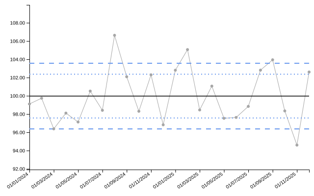

``` r

knitr::kable(head(chart_xbar$limits), digits = 2)
```

| date       |  value | target |  ll99 |  ll95 |  ll68 |   ul68 |   ul95 |   ul99 | trend_line |
|:-----------|-------:|-------:|------:|------:|------:|-------:|-------:|-------:|-----------:|
| 01/01/2024 |  99.11 |  99.97 | 96.37 | 97.57 | 98.77 | 101.17 | 102.37 | 103.56 |      99.52 |
| 01/02/2024 |  99.74 |  99.97 | 96.37 | 97.57 | 98.77 | 101.17 | 102.37 | 103.56 |      99.56 |
| 01/03/2024 |  96.38 |  99.97 | 96.37 | 97.57 | 98.77 | 101.17 | 102.37 | 103.56 |      99.60 |
| 01/04/2024 |  98.11 |  99.97 | 96.37 | 97.57 | 98.77 | 101.17 | 102.37 | 103.56 |      99.64 |
| 01/05/2024 |  97.13 |  99.97 | 96.37 | 97.57 | 98.77 | 101.17 | 102.37 | 103.56 |      99.67 |
| 01/06/2024 | 100.52 |  99.97 | 96.37 | 97.57 | 98.77 | 101.17 | 102.37 | 103.56 |      99.71 |

#### s Chart (Sample Standard Deviations)

Monitors the standard deviation of samples.

``` r

chart_s <- spc(data = dat_xbar,
               keys = month,
               numerators = sample_sd,
               denominators = sample_size,
               spc_settings = list(chart_type = "s"))

chart_s$static_plot
```

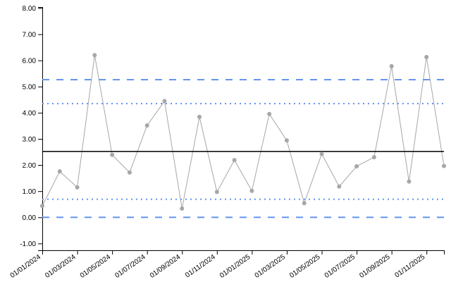

### Event-Based Charts

Event-based charts use sequential event numbers on the x-axis rather
than dates.

#### g Chart (Geometric)

Monitors the number of non-events between events (e.g., days between
accidents).

``` r

dat_g <- data.frame(
  event = 1:20,
  opportunities_between = rpois(20, lambda = 15)
)

chart_g <- spc(data = dat_g,
               keys = event,
               numerators = opportunities_between,
               spc_settings = list(chart_type = "g"))

chart_g$static_plot
```

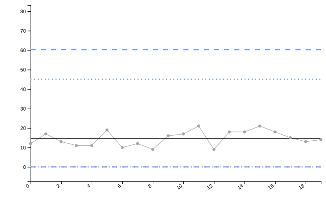

``` r

knitr::kable(head(chart_g$limits), digits = 2)
```

| date | value | target | ll99 | ll95 | ll68 |  ul68 |  ul95 |  ul99 | trend_line |
|:-----|------:|-------:|-----:|-----:|-----:|------:|------:|------:|-----------:|
| 0    |    12 |   14.5 |    0 |    0 |    0 | 29.89 | 45.08 | 60.28 |      12.77 |
| 1    |    17 |   14.5 |    0 |    0 |    0 | 29.89 | 45.08 | 60.28 |      12.97 |
| 2    |    13 |   14.5 |    0 |    0 |    0 | 29.89 | 45.08 | 60.28 |      13.18 |
| 3    |    11 |   14.5 |    0 |    0 |    0 | 29.89 | 45.08 | 60.28 |      13.38 |
| 4    |    11 |   14.5 |    0 |    0 |    0 | 29.89 | 45.08 | 60.28 |      13.58 |
| 5    |    19 |   14.5 |    0 |    0 |    0 | 29.89 | 45.08 | 60.28 |      13.79 |

#### t Chart (Time Between Events)

Monitors the time intervals between events.

``` r

dat_t <- data.frame(
  event = 1:20,
  days_between = rexp(20, rate = 1 / 30)
)

chart_t <- spc(data = dat_t,
               keys = event,
               numerators = days_between,
               spc_settings = list(chart_type = "t"))

chart_t$static_plot
```

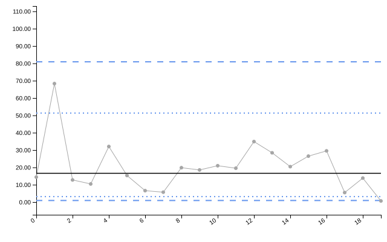

``` r

knitr::kable(head(chart_t$limits), digits = 2)
```

| date | value | target | ll99 | ll95 | ll68 | ul68 |  ul95 | ul99 | trend_line |
|:-----|------:|-------:|-----:|-----:|-----:|-----:|------:|-----:|-----------:|
| 0    | 14.40 |  16.59 | 0.92 | 3.17 | 7.97 | 30.5 | 51.34 | 80.9 |      25.67 |
| 1    | 68.34 |  16.59 | 0.92 | 3.17 | 7.97 | 30.5 | 51.34 | 80.9 |      25.09 |
| 2    | 12.76 |  16.59 | 0.92 | 3.17 | 7.97 | 30.5 | 51.34 | 80.9 |      24.52 |
| 3    | 10.45 |  16.59 | 0.92 | 3.17 | 7.97 | 30.5 | 51.34 | 80.9 |      23.95 |
| 4    | 32.05 |  16.59 | 0.92 | 3.17 | 7.97 | 30.5 | 51.34 | 80.9 |      23.37 |
| 5    | 15.34 |  16.59 | 0.92 | 3.17 | 7.97 | 30.5 | 51.34 | 80.9 |      22.80 |

## Funnel Plot Types

Funnel plots are used to compare performance across multiple
organizations or groups, accounting for natural variation due to
different sample sizes.

### PR - Proportion Funnel

The default funnel plot type for proportion data. Uses arc-sine
transformation.

``` r

# Simulate complication rates across 10 hospitals
denoms_pr <- sample(100:300, 10)
dat_pr <- data.frame(
  hospital = paste0("Hospital ", LETTERS[1:10]),
  complications = rbinom(10, size = denoms_pr, prob = 0.12),
  procedures = denoms_pr
)

funnel_pr <- funnel(data = dat_pr,
                    keys = hospital,
                    numerators = complications,
                    denominators = procedures,
                    funnel_settings = list(chart_type = "PR"))

funnel_pr$static_plot
```


``` r

knitr::kable(funnel_pr$limits, digits = 3)
```

| denominator | group | numerator | value | z | target | ll99 | ll95 | ll68 | ul68 | ul95 | ul99 |
|---:|:---|---:|---:|---:|---:|---:|---:|---:|---:|---:|---:|
| 139 | Hospital G | 19 | 13.669 | 0.867 | 11.242 | 4.381 | 6.549 | 8.719 | 14.041 | 17.004 | 20.751 |
| 148 | Hospital A | 24 | 16.216 | 1.765 | 11.242 | 4.548 | 6.677 | 8.792 | 13.951 | 16.811 | 20.424 |
| 166 | Hospital I | 18 | 10.843 | -0.164 | 11.242 | 4.848 | 6.903 | 8.922 | 13.793 | 16.477 | 19.856 |
| 179 | Hospital D | 13 | 7.263 | -1.848 | 11.242 | 5.040 | 7.046 | 9.004 | 13.695 | 16.268 | 19.503 |
| 191 | Hospital F | 19 | 9.948 | -0.582 | 11.242 | 5.203 | 7.167 | 9.072 | 13.614 | 16.096 | 19.212 |
| 215 | Hospital B | 31 | 14.419 | 1.395 | 11.242 | 5.492 | 7.378 | 9.191 | 13.472 | 15.798 | 18.708 |
| 242 | Hospital C | 23 | 9.504 | -0.888 | 11.242 | 5.771 | 7.580 | 9.304 | 13.339 | 15.519 | 18.238 |
| 260 | Hospital E | 30 | 11.538 | 0.150 | 11.242 | 5.935 | 7.698 | 9.369 | 13.263 | 15.358 | 17.969 |
| 284 | Hospital J | 34 | 11.972 | 0.384 | 11.242 | 6.132 | 7.839 | 9.447 | 13.173 | 15.170 | 17.652 |
| 293 | Hospital H | 27 | 9.215 | -1.147 | 11.242 | 6.200 | 7.887 | 9.474 | 13.142 | 15.105 | 17.544 |

#### PR Funnel with Overdispersion Adjustment

When data shows more variation than expected, overdispersion adjustment
widens the control limits.

``` r

funnel_pr_od <- funnel(data = dat_pr,
                       keys = hospital,
                       numerators = complications,
                       denominators = procedures,
                       funnel_settings = list(chart_type = "PR",
                                              od_adjust = "yes"))

funnel_pr_od$static_plot
```

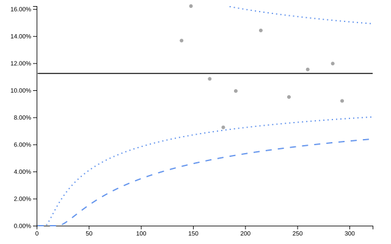

``` r

knitr::kable(funnel_pr_od$limits, digits = 3)
```

| denominator | group | numerator | value | z | target | ll99 | ll95 | ll68 | ul68 | ul95 | ul99 |
|---:|:---|---:|---:|---:|---:|---:|---:|---:|---:|---:|---:|
| 139 | Hospital G | 19 | 13.669 | 0.867 | 11.242 | 4.381 | 6.549 | 8.719 | 14.041 | 17.004 | 20.751 |
| 148 | Hospital A | 24 | 16.216 | 1.765 | 11.242 | 4.548 | 6.677 | 8.792 | 13.951 | 16.811 | 20.424 |
| 166 | Hospital I | 18 | 10.843 | -0.164 | 11.242 | 4.848 | 6.903 | 8.922 | 13.793 | 16.477 | 19.856 |
| 179 | Hospital D | 13 | 7.263 | -1.848 | 11.242 | 5.040 | 7.046 | 9.004 | 13.695 | 16.268 | 19.503 |
| 191 | Hospital F | 19 | 9.948 | -0.582 | 11.242 | 5.203 | 7.167 | 9.072 | 13.614 | 16.096 | 19.212 |
| 215 | Hospital B | 31 | 14.419 | 1.395 | 11.242 | 5.492 | 7.378 | 9.191 | 13.472 | 15.798 | 18.708 |
| 242 | Hospital C | 23 | 9.504 | -0.888 | 11.242 | 5.771 | 7.580 | 9.304 | 13.339 | 15.519 | 18.238 |
| 260 | Hospital E | 30 | 11.538 | 0.150 | 11.242 | 5.935 | 7.698 | 9.369 | 13.263 | 15.358 | 17.969 |
| 284 | Hospital J | 34 | 11.972 | 0.384 | 11.242 | 6.132 | 7.839 | 9.447 | 13.173 | 15.170 | 17.652 |
| 293 | Hospital H | 27 | 9.215 | -1.147 | 11.242 | 6.200 | 7.887 | 9.474 | 13.142 | 15.105 | 17.544 |

### SR - Standardised Ratio Funnel

Used for indirectly standardized ratios (e.g., HSMR - Hospital
Standardised Mortality Ratio).

``` r

# Simulate observed and expected deaths
dat_sr <- data.frame(
  hospital = paste0("Hospital ", LETTERS[1:10]),
  observed_deaths = rpois(10, lambda = sample(30:80, 10)),
  expected_deaths = sample(30:80, 10)
)

funnel_sr <- funnel(data = dat_sr,
                    keys = hospital,
                    numerators = observed_deaths,
                    denominators = expected_deaths,
                    funnel_settings = list(chart_type = "SR"))

funnel_sr$static_plot
```

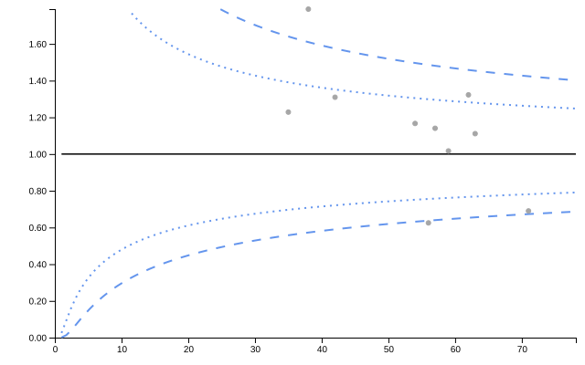

``` r

knitr::kable(funnel_sr$limits, digits = 3)
```

| denominator | group | numerator | value | z | target | ll99 | ll95 | ll68 | ul68 | ul95 | ul99 |
|---:|:---|---:|---:|---:|---:|---:|---:|---:|---:|---:|---:|
| 35 | Hospital I | 43 | 1.229 | 1.153 | 1 | 0.558 | 0.697 | 0.833 | 1.198 | 1.391 | 1.641 |
| 38 | Hospital J | 68 | 1.789 | 3.876 | 1 | 0.572 | 0.708 | 0.839 | 1.189 | 1.373 | 1.610 |
| 42 | Hospital F | 55 | 1.310 | 1.733 | 1 | 0.590 | 0.721 | 0.847 | 1.178 | 1.352 | 1.575 |
| 54 | Hospital B | 63 | 1.167 | 1.075 | 1 | 0.632 | 0.751 | 0.865 | 1.155 | 1.305 | 1.496 |
| 56 | Hospital A | 35 | 0.625 | -3.216 | 1 | 0.637 | 0.755 | 0.867 | 1.151 | 1.299 | 1.486 |
| 57 | Hospital D | 65 | 1.140 | 0.928 | 1 | 0.640 | 0.757 | 0.869 | 1.150 | 1.296 | 1.481 |
| 59 | Hospital G | 60 | 1.017 | 0.043 | 1 | 0.645 | 0.761 | 0.871 | 1.147 | 1.290 | 1.471 |
| 62 | Hospital H | 82 | 1.323 | 2.229 | 1 | 0.653 | 0.767 | 0.874 | 1.143 | 1.282 | 1.458 |
| 63 | Hospital C | 70 | 1.111 | 0.769 | 1 | 0.655 | 0.768 | 0.875 | 1.142 | 1.279 | 1.454 |
| 71 | Hospital E | 49 | 0.690 | -2.902 | 1 | 0.673 | 0.781 | 0.882 | 1.133 | 1.261 | 1.424 |

#### SR Funnel with Overdispersion Adjustment

``` r

funnel_sr_od <- funnel(data = dat_sr,
                       keys = hospital,
                       numerators = observed_deaths,
                       denominators = expected_deaths,
                       funnel_settings = list(chart_type = "SR",
                                              od_adjust = "yes"))

funnel_sr_od$static_plot
```

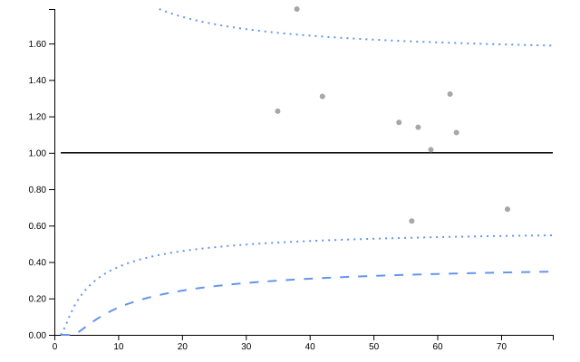

``` r

knitr::kable(funnel_sr_od$limits, digits = 3)
```

| denominator | group | numerator | value | z | target | ll99 | ll95 | ll68 | ul68 | ul95 | ul99 |
|---:|:---|---:|---:|---:|---:|---:|---:|---:|---:|---:|---:|
| 35 | Hospital I | 43 | 1.229 | 0.738 | 1 | 0.298 | 0.507 | 0.729 | 1.314 | 1.659 | 2.115 |
| 38 | Hospital J | 68 | 1.789 | 2.328 | 1 | 0.304 | 0.512 | 0.732 | 1.309 | 1.649 | 2.097 |
| 42 | Hospital F | 55 | 1.310 | 1.010 | 1 | 0.312 | 0.518 | 0.736 | 1.304 | 1.638 | 2.078 |
| 54 | Hospital B | 63 | 1.167 | 0.580 | 1 | 0.328 | 0.532 | 0.744 | 1.294 | 1.615 | 2.036 |
| 56 | Hospital A | 35 | 0.625 | -1.522 | 1 | 0.331 | 0.533 | 0.745 | 1.292 | 1.612 | 2.031 |
| 57 | Hospital D | 65 | 1.140 | 0.494 | 1 | 0.332 | 0.534 | 0.746 | 1.292 | 1.610 | 2.028 |
| 59 | Hospital G | 60 | 1.017 | 0.062 | 1 | 0.333 | 0.536 | 0.747 | 1.290 | 1.608 | 2.024 |
| 62 | Hospital H | 82 | 1.323 | 1.103 | 1 | 0.336 | 0.538 | 0.748 | 1.289 | 1.604 | 2.017 |
| 63 | Hospital C | 70 | 1.111 | 0.398 | 1 | 0.337 | 0.539 | 0.748 | 1.288 | 1.603 | 2.015 |
| 71 | Hospital E | 49 | 0.690 | -1.262 | 1 | 0.343 | 0.543 | 0.751 | 1.284 | 1.595 | 2.000 |

### RC - Rate Funnel

Used for rate data with log transformation.

``` r

# Simulate infection rates across hospitals
dat_rc <- data.frame(
  hospital = paste0("Hospital ", LETTERS[1:10]),
  infections = rpois(10, lambda = sample(5:20, 10)),
  patient_days = sample(500:2000, 10)
)

funnel_rc <- funnel(data = dat_rc,
                    keys = hospital,
                    numerators = infections,
                    denominators = patient_days,
                    funnel_settings = list(chart_type = "RC",
                                           multiplier = 1000))

funnel_rc$static_plot
```

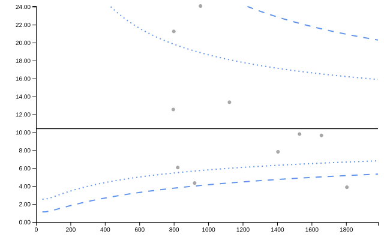

``` r

knitr::kable(funnel_rc$limits, digits = 3)
```

| denominator | group | numerator | value | z | target | ll99 | ll95 | ll68 | ul68 | ul95 | ul99 |
|---:|:---|---:|---:|---:|---:|---:|---:|---:|---:|---:|---:|
| 797 | Hospital C | 10 | 12.547 | 0.567 | 10.41 | 3.762 | 5.459 | 7.502 | 14.444 | 19.851 | 28.804 |
| 800 | Hospital H | 17 | 21.250 | 2.170 | 10.41 | 3.768 | 5.465 | 7.506 | 14.436 | 19.830 | 28.755 |
| 823 | Hospital I | 5 | 6.075 | -1.659 | 10.41 | 3.817 | 5.509 | 7.537 | 14.377 | 19.670 | 28.391 |
| 921 | Hospital E | 4 | 4.343 | -2.832 | 10.41 | 4.010 | 5.684 | 7.658 | 14.150 | 19.064 | 27.024 |
| 955 | Hospital G | 23 | 24.084 | 2.762 | 10.41 | 4.072 | 5.740 | 7.696 | 14.080 | 18.878 | 26.609 |
| 1123 | Hospital A | 15 | 13.357 | 0.884 | 10.41 | 4.354 | 5.989 | 7.863 | 13.780 | 18.094 | 24.888 |
| 1405 | Hospital D | 11 | 7.829 | -1.120 | 10.41 | 4.745 | 6.324 | 8.084 | 13.404 | 17.134 | 22.837 |
| 1530 | Hospital F | 15 | 9.804 | -0.245 | 10.41 | 4.893 | 6.449 | 8.165 | 13.272 | 16.802 | 22.146 |
| 1657 | Hospital B | 16 | 9.656 | -0.319 | 10.41 | 5.031 | 6.564 | 8.238 | 13.154 | 16.509 | 21.538 |
| 1805 | Hospital J | 7 | 3.878 | -4.370 | 10.41 | 5.178 | 6.685 | 8.315 | 13.032 | 16.209 | 20.925 |

#### RC Funnel with Overdispersion Adjustment

``` r

funnel_rc_od <- funnel(data = dat_rc,
                       keys = hospital,
                       numerators = infections,
                       denominators = patient_days,
                       funnel_settings = list(chart_type = "RC",
                                              od_adjust = "yes",
                                              multiplier = 1000))

funnel_rc_od$static_plot
```

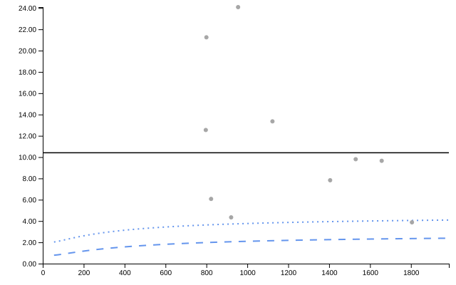

``` r

knitr::kable(funnel_rc_od$limits, digits = 3)
```

| denominator | group | numerator | value | z | target | ll99 | ll95 | ll68 | ul68 | ul95 | ul99 |
|---:|:---|---:|---:|---:|---:|---:|---:|---:|---:|---:|---:|
| 797 | Hospital C | 10 | 12.547 | 0.347 | 10.41 | 1.977 | 3.630 | 6.099 | 17.766 | 29.852 | 54.806 |
| 800 | Hospital H | 17 | 21.250 | 1.328 | 10.41 | 1.979 | 3.632 | 6.101 | 17.760 | 29.832 | 54.749 |
| 823 | Hospital I | 5 | 6.075 | -1.007 | 10.41 | 1.995 | 3.650 | 6.117 | 17.716 | 29.686 | 54.326 |
| 921 | Hospital E | 4 | 4.343 | -1.665 | 10.41 | 2.054 | 3.719 | 6.175 | 17.548 | 29.136 | 52.747 |
| 955 | Hospital G | 23 | 24.084 | 1.606 | 10.41 | 2.073 | 3.741 | 6.193 | 17.497 | 28.969 | 52.271 |
| 1123 | Hospital A | 15 | 13.357 | 0.489 | 10.41 | 2.153 | 3.832 | 6.269 | 17.285 | 28.280 | 50.325 |
| 1405 | Hospital D | 11 | 7.829 | -0.575 | 10.41 | 2.254 | 3.945 | 6.362 | 17.031 | 27.469 | 48.068 |
| 1530 | Hospital F | 15 | 9.804 | -0.122 | 10.41 | 2.290 | 3.984 | 6.394 | 16.946 | 27.199 | 47.325 |
| 1657 | Hospital B | 16 | 9.656 | -0.155 | 10.41 | 2.321 | 4.019 | 6.423 | 16.872 | 26.964 | 46.682 |
| 1805 | Hospital J | 7 | 3.878 | -2.052 | 10.41 | 2.353 | 4.054 | 6.451 | 16.797 | 26.730 | 46.044 |

## Chart Selection Guide

### SPC Chart Selection

| Data Type | Chart Type | When to Use |
|----|----|----|
| Individual measurements | `i`, `i_m`, `i_mm` | Single measurement per time point |
| Ratios/efficiency metrics | `i` with denominators | Monitoring rates calculated from num/denom |
| Moving ranges | `mr` | Monitoring variation between consecutive points |
| Proportions | `p`, `pp` | Numerator ≤ denominator (e.g., defect rates) |
| Rates | `u`, `up` | Events per unit exposure (any ratio) |
| Counts | `c` | Fixed area of opportunity |
| Sample means | `xbar` | Multiple measurements per time point |
| Sample SDs | `s` | Monitoring within-sample variation |
| Opportunities between events | `g` | Count of non-events between events |
| Time between events | `t` | Continuous time intervals |
| Trend visualization only | `run` | No statistical limits needed |

### Funnel Plot Selection

| Data Type | Chart Type | When to Use |
|----|----|----|
| Proportions | `PR` | Numerator ≤ denominator (complication rates, readmissions) |
| Standardised ratios | `SR` | Observed/expected (mortality, morbidity ratios) |
| Rates | `RC` | Events per exposure (infections per patient-days) |

### Overdispersion Adjustment

Use `od_adjust = "yes"` when: - Data shows more variation than expected
from binomial/Poisson models - There is clustering or hierarchical
structure in the data - Groups have different underlying risks not
captured by standardization - Control limits appear too narrow for the
observed variation

## Data Requirements Summary

### SPC Charts

| Chart Type            | Numerator | Denominator | Standard Deviation |
|-----------------------|:---------:|:-----------:|:------------------:|
| run, i, i_m, i_mm, mr |     ✓     | Optional\*  |         \-         |
| p, pp                 |     ✓     |      ✓      |         \-         |
| u, up                 |     ✓     |      ✓      |         \-         |
| c                     |     ✓     |     \-      |         \-         |
| xbar                  |     ✓     |      ✓      |         ✓          |
| s                     |   ✓\*\*   |      ✓      |         \-         |
| g, t                  |     ✓     |     \-      |         \-         |

\*Optional denominator creates a ratio chart \*\*For s-chart, numerator
contains standard deviation values

### Funnel Plots

All funnel plot types require: - Keys (organization/group identifier) -
Numerators (event counts or observed values) - Denominators (sample
sizes or expected values)

Additional constraints: - **PR**: Numerator must be ≤ denominator -
**SR**: Typically observed/expected counts or deaths - **RC**: Any rate
data (events/exposure)

## Additional Resources

For more information, see: -
[`vignette("getting_started")`](https://aus-doh-safety-and-quality.github.io/controlcharts/articles/getting_started.md) -
Basic package usage - `vignette("interactive_charts")` - Interactive
features with crosstalk
